Twenty-seven weapons for [Fatal Contact](https://github.com/zees-games/game-fatal-contact) (FC), from a knife and four sidearms to a minigun, a rail rifle and five kinds of grenade. Each has its own 3D model, sounds and a tuned profile, and every number below is a default read straight from the pack's data that a game or server can change without touching the pack.

### In GameSpice and Fatal Contact

- **GameSpice:** the pack is published to the Workshop as `gamemann/fc-weapons`. Fatal Contact servers load it through the pack overlay, so players get it with the server and there is nothing to install. Other games and servers add it to their pack list to get the same weapons.
- **Fatal Contact:** FC requires this pack and loads it by default. Its weapons fill the melee, sidearm, primary, heavy and thrown slots, and server owners retune them in `cfg/addons/fc_weapons/weapon/<id>.yml`.
- **Your own Godot game:** link or copy `addons/fc_weapons` beside dot-weapon and use the code in [Using it](#using-it).

The pack holds the weapon definitions (stats, ammunition, reloads, view and aim holds), 3D models, sounds and the runtime that draws and fires them in first and third person.

Models come from CC0 packs, baked to one contract: origin at the grip, muzzle toward -Z, metres. The code is MIT. See [CREDITS.md](CREDITS.md) for every asset.

Pack id: `gamemann/fc-weapons` (it was `gamemann/arena-weapons` up to v1.3.x). The addon directory is `addons/fc_weapons` (it was `addons/arena_weapons` up to API level 31) and its classes still start with `Aw`.

<!-- gen_readme:summary -->
| | Weapon | Class | Damage | Fire rate |
| --- | --- | --- | --- | --- |
| <a href="#knife">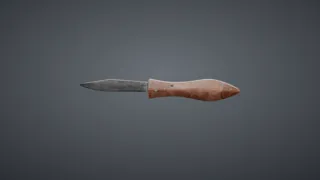</a> | [Knife](#knife) | Melee | 45 | one swing every 0.41 s |
| <a href="#pistol">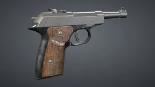</a> | [Pistol](#pistol) | Pistol | 20 | one shot every 0.16 s |
| <a href="#revolver">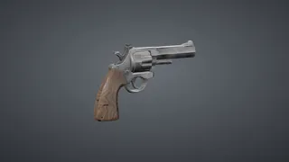</a> | [Revolver](#revolver) | Pistol | 45 | one shot every 0.41 s |
| <a href="#machine-pistol">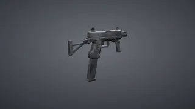</a> | [Machine Pistol](#machine-pistol) | Pistol | 13 | 960 rpm |
| <a href="#derringer">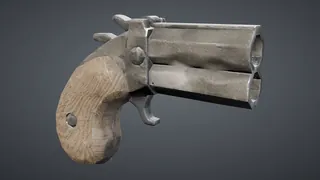</a> | [Derringer](#derringer) | Pistol | 62 | one shot every 0.67 s |
| <a href="#smg">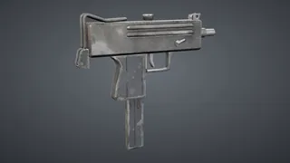</a> | [SMG](#smg) | SMG | 16 | 768 rpm |
| <a href="#carbine">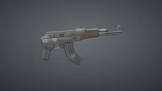</a> | [Carbine](#carbine) | Assault rifle | 21 | 640 rpm |
| <a href="#assault-rifle">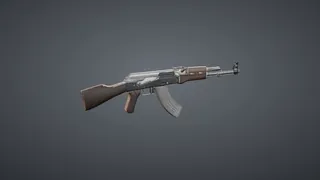</a> | [Assault Rifle](#assault-rifle) | Assault rifle | 23 | 640 rpm |
| <a href="#bullpup">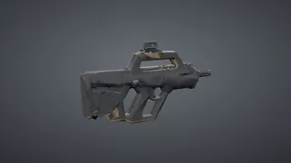</a> | [Bullpup](#bullpup) | Assault rifle | 20 | 768 rpm |
| <a href="#battle-rifle">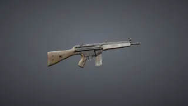</a> | [Battle Rifle](#battle-rifle) | Battle rifle | 36 | one shot every 0.2 s |
| <a href="#burst-rifle">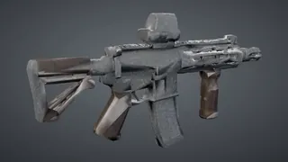</a> | [Burst Rifle](#burst-rifle) | Burst rifle | 24 | one shot every 0.25 s |
| <a href="#shotgun">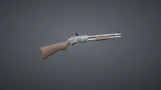</a> | [Shotgun](#shotgun) | Shotgun | 12 x 9 | one shot every 0.8 s |
| <a href="#drum-shotgun">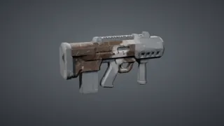</a> | [Drum Shotgun](#drum-shotgun) | Shotgun | 8 x 7 | one shot every 0.31 s |
| <a href="#marksman-rifle">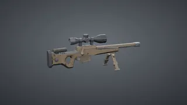</a> | [Marksman Rifle](#marksman-rifle) | Marksman rifle | 58 | one shot every 0.33 s |
| <a href="#light-machine-gun">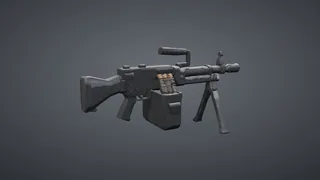</a> | [Light Machine Gun](#light-machine-gun) | LMG | 21 | 768 rpm |
| <a href="#sniper-rifle">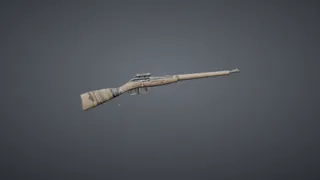</a> | [Sniper Rifle](#sniper-rifle) | Sniper rifle | 118 | one shot every 1.33 s |
| <a href="#minigun">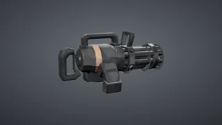</a> | [Minigun](#minigun) | Heavy | 11 | 1280 rpm |
| <a href="#rocket-launcher">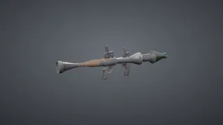</a> | [Rocket Launcher](#rocket-launcher) | Launcher | 32 | one shot every 0.86 s |
| <a href="#quad-rocket-launcher">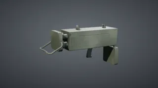</a> | [Quad Rocket Launcher](#quad-rocket-launcher) | Launcher | 24 | one shot every 0.25 s |
| <a href="#grenade-launcher">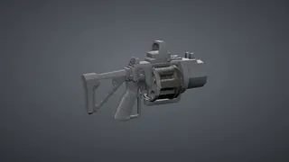</a> | [Grenade Launcher](#grenade-launcher) | Launcher | 20 | one shot every 0.67 s |
| <a href="#plasma-beamer">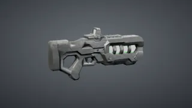</a> | [Plasma Beamer](#plasma-beamer) | Energy | 9 | 960 rpm |
|  | [Rail Rifle](#rail-rifle) | Energy | 105 | one shot every 0.67 s |
| <a href="#frag-grenade">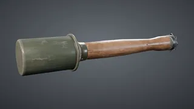</a> | [Frag Grenade](#frag-grenade) | Grenade | 115 splash | one throw every 1 s |
| <a href="#sticky-grenade">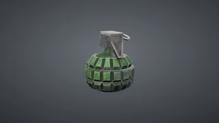</a> | [Sticky Grenade](#sticky-grenade) | Grenade | 135 splash | one throw every 1 s |
| <a href="#flashbang">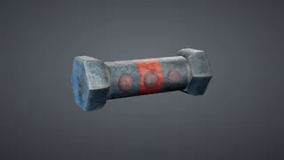</a> | [Flashbang](#flashbang) | Grenade | - | one throw every 1 s |
| <a href="#smoke-grenade">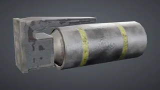</a> | [Smoke Grenade](#smoke-grenade) | Grenade | - | one throw every 1 s |
| <a href="#incendiary-grenade">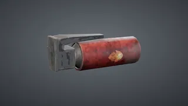</a> | [Incendiary Grenade](#incendiary-grenade) | Grenade | 25 splash | one throw every 1 s |

*Rates are the time between shots and ignore reloading; rpm is the cyclic rate of an automatic weapon.*
<!-- /gen_readme:summary -->

## Using it

FC requires this pack. It registers the weapons under plain ids (`rifle`) and runs them on this pack's runtime. A game that mixes several weapon packs (zombie-zone, Playlot) calls `weapon_defs()`, `art_rows()` and `spawn_entries()` on `AwSpawnProvider` and gets ids with an `aw_` prefix. `role_art()` dresses a game's own weapons by role.

Link `addons/fc_weapons` into your project, or let `dot-bootstrap` do it. The current API level is 31 (see `addons/fc_weapons/fc_weapons_api.gd`, which also lists what each level added). It needs dot-weapon API 42 or newer (`AwWeaponRig.setup()` fails with a message on an older one); dot-sim from 1a28540 is optional and moves the hitscan spread tick to native code (`AwWeaponRig.native_spread`, on by default, bit-exact with the GDScript tick).

## Weapons

| Slot | Weapons |
| --- | --- |
| 1 melee | `knife` |
| 2 sidearm | `pistol`, `revolver`, `machine_pistol`, `derringer` |
| 3 primary | `smg`, `carbine`, `rifle`, `bullpup`, `battle_rifle`, `burst_rifle`, `shotgun`, `drum_shotgun`, `marksman`, `lmg` |
| 4 heavy | `sniper`, `minigun`, `launcher`, `quad_launcher`, `grenade_launcher`, `beamer`, `charge_rifle` |
| 5 thrown | `frag`, `sticky`, plus `flash`, `smoke` and `incendiary` utility grenades |

Models for ammo boxes, extra grenades and rounds also ship, for a game's pickups and effects.

## Settings

Every stat of every weapon is tunable in `cfg/addons/fc_weapons/weapon/<id>.yml` (through dot-weapon's `DotWeaponProfiles`). Nothing is fixed in code: set a value in the file to change it.

| Setting | What it does |
| --- | --- |
| `fire_modes` | Fire modes of a weapon. The first entry is the starting mode. Automatic guns also fire semi. SMGs, carbines and rifles also burst. |
| `sv_grenade_*` cvars | Grenade flight, bounce, stick and fuse rules (`AwGrenadeRules`) |

The host binds `DotWeaponCommand.BUTTON_FIRE_MODE` to switch modes.

## What is in the pack

| Path | Contents |
| --- | --- |
| `addons/fc_weapons/aw_weapon_pack.gd` | `AwWeaponPack`, the weapon definitions |
| `addons/fc_weapons/aw_weapon_art.gd` | `AwWeaponArt`, the only file that names a model |
| `addons/fc_weapons/spawn_provider.gd` | `AwSpawnProvider`, the contract a game uses |
| `addons/fc_weapons/assets/` | Models (`models/`), attachment models, per-gun sounds |
| `weapons/*.tres` | Weapon resources |
| `groups.json` | Download groups, one per weapon (`weapon-<id>`) |
| `tools/` | Baking and measuring scripts (Blender models, sight points, attachments) |
| `examples/aw_selftest.tscn` | The headless test suite |
| `examples/aw_selftest_ads.tscn` | Checks motion down the sights and through a scope |

## Features for a host game

- **Grenades and utility zones.** `AwUtilityZones` runs flash, smoke and incendiary grenades. The game calls `detonate(grenade, def)` when one goes off and `tick(delta)` once per game tick, and supplies its combat rules (`victims`, `los`, `damage`) so friendly fire and armour stay its own. On the client `AwGrenadeFx` plays the effects. Needs dot-fx.
- **Attachments.** Ten attachments (`att_<id>`): red dot, holographic, 3x prism, 6x scope, suppressor, compensator, vertical and angled grips, laser, extended magazine. Each gun lists the mounts its model has. The server checks a fitting with `validate_fitting`.
- **Sounds.** Each gun has its own layered shot sound in `assets/sounds/`. Other sounds (reload, dry click, equip) come from dot-audio's stock by sound class (`AwSpawnProvider.sound_classes()`).
- **Inspect and holster.** `AwViewModel.inspect()` plays a look-over of the gun. It moves only the view, never the shot or the net.
- **Knife throw and sprint.** Each frame the game passes the throw meter to `AwViewModel.on_windup(charge)` (dot-weapon's `charge_of`: 0 to 1 while winding up, below 0 when not); the hand draws back past the ear and the throw releases from there. A blade pumps with the stride on a sprint; arms that show the free hand read `AwViewModel.run_amount()` and `run_phase()` to pump it.
- **Effects pool.** `AwFxPool` builds shot effects ahead of time under a loading cover, so the first remote shot does not stall a tick. An empty pool is not an error.
- **Download groups.** A web shell sets `DotCloudAddonSet.groups` to `AwWeaponGroups.groups_for(ids)` for the weapons its loadout can hand out. List every weapon a player can receive, because a deferred group cannot be added at runtime.
- **Builds without models.** A build that leaves `assets/` out (the web shell) can draw models from a mounted pack: call `AwModelCache.add_fallback_root(...)` after mounting and `remove_fallback_root` when leaving. Until then each weapon still fires and is drawn invisible, with one warning per model.

## Tests

Open `examples/aw_selftest.tscn` headless in Godot for the main suite, and `examples/aw_selftest_ads.tscn` for the aiming checks. Fatal Contact's own test run covers them too.

<!-- gen_readme:weapons -->
## The weapons

### Knife

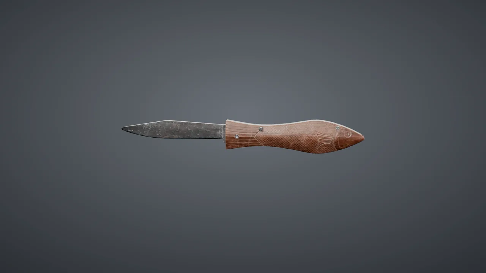

**Melee** `knife`. Always in hand and always ready. A quick stab with a short reach that rewards getting behind someone.

| Default | |
| --- | --- |
| Damage | 45 (strike) |
| Fire rate | one swing every 0.41 s |
| Fire modes | semi |
| Reach | 1.9 m |
| Swing arc | 24 deg |
| Draw time | 0.16 s |
| Weight | 0.4 kg |

*Rates are the time between shots and ignore reloading; rpm is the cyclic rate of an automatic weapon.*

### Pistol

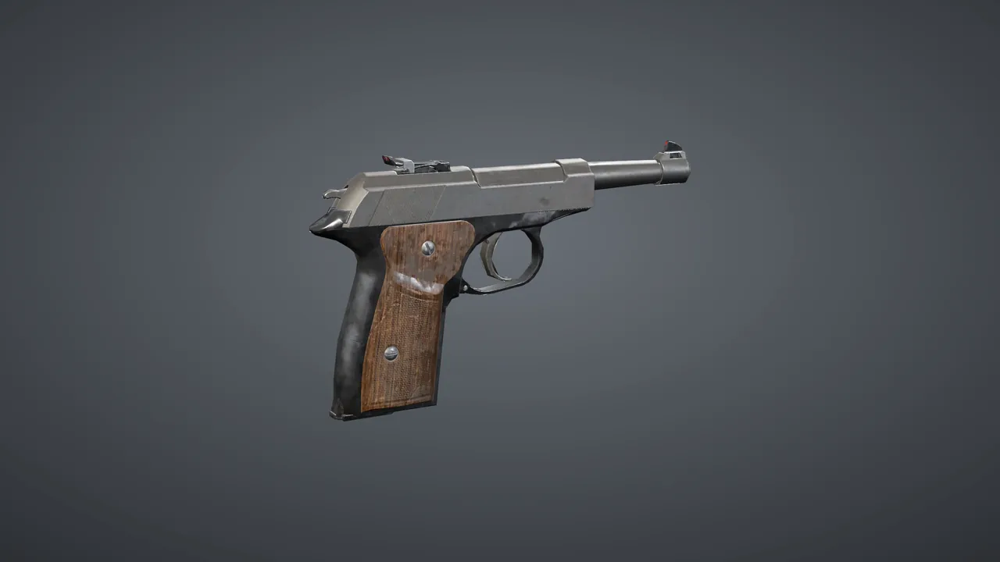

**Pistol** `pistol`. The dependable sidearm. Accurate, quick to draw and fast to reload, with enough rounds to finish what the main gun started.

| Default | |
| --- | --- |
| Damage | 20 (dart) |
| Fire rate | one shot every 0.16 s |
| Fire modes | semi |
| Magazine | 15 + 60 reserve |
| Reload | 1.59 s |
| Spread | 0.35 deg standing, 1.5 moving, 0.5 crouched, 4 airborne |
| Bloom | +0.3 deg per shot, up to 2.6 |
| Recoil | 0.5 deg up, 0.15 deg side |
| Range | 120 m |
| Draw time | 0.22 s |
| Weight | 1 kg |

*Rates are the time between shots and ignore reloading; rpm is the cyclic rate of an automatic weapon.*

### Revolver

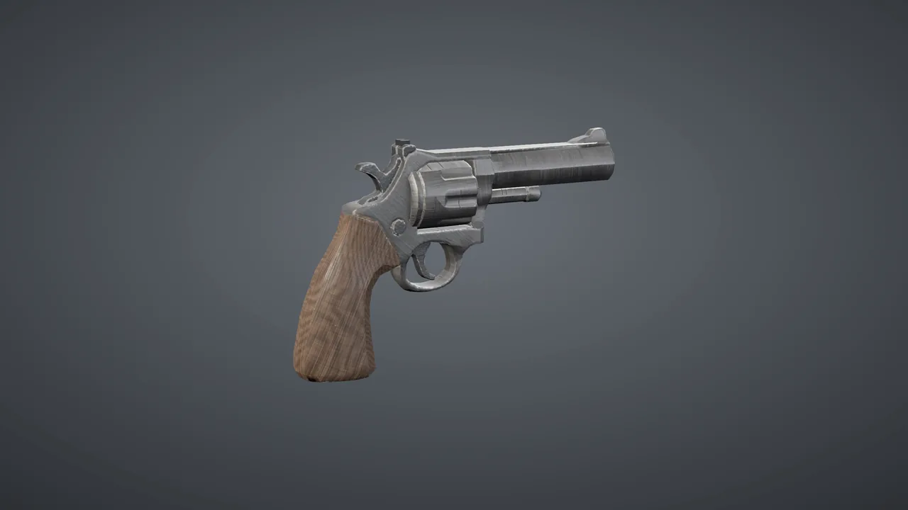

**Pistol** `revolver`. Six heavy rounds and a stiff kick. Two clean hits drop most targets, so every trigger pull counts.

| Default | |
| --- | --- |
| Damage | 45 (dart) |
| Fire rate | one shot every 0.41 s |
| Fire modes | semi |
| Magazine | 6 + 36 reserve |
| Reload | 2.41 s |
| Spread | 0.2 deg standing, 2 moving, 0.3 crouched, 5 airborne |
| Bloom | +1.2 deg per shot, up to 4 |
| Recoil | 2.2 deg up, 0.3 deg side |
| Range | 140 m |
| Draw time | 0.3 s |
| Weight | 1.2 kg |

*Rates are the time between shots and ignore reloading; rpm is the cyclic rate of an automatic weapon.*

### Machine Pistol

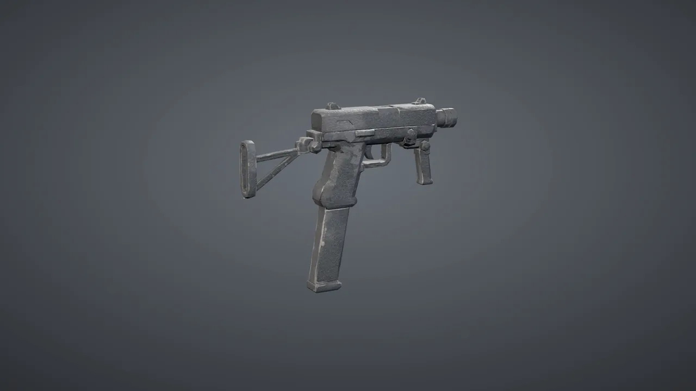

**Pistol** `machine_pistol`. A pocket bullet hose. The fastest cyclic rate in the pack outside the minigun, with burst and semi for when spraying is not the answer.

| Default | |
| --- | --- |
| Damage | 13 (dart) |
| Fire rate | 960 rpm |
| Fire modes | auto, semi, burst |
| Burst | 3 rounds |
| Magazine | 25 + 100 reserve |
| Reload | 1.91 s |
| Spread | 0.9 deg standing, 3.2 moving, 0.7 crouched, 6 airborne |
| Bloom | +0.32 deg per shot, up to 5.5 |
| Recoil | 0.3 deg up, 0.18 deg side |
| Range | 70 m |
| Draw time | 0.25 s |
| Weight | 1.4 kg |

*Rates are the time between shots and ignore reloading; rpm is the cyclic rate of an automatic weapon.*

### Derringer

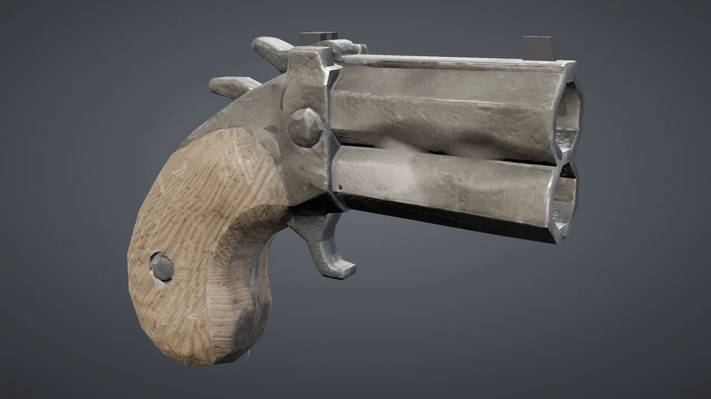

**Pistol** `derringer`. Two barrels, two shots, big damage at arm's length. A last-ditch backup that wins a corner fight and little else.

| Default | |
| --- | --- |
| Damage | 62 (dart) |
| Fire rate | one shot every 0.67 s |
| Fire modes | semi |
| Magazine | 2 + 12 reserve |
| Reload | 2 s |
| Spread | 2.2 deg standing, 5 moving, 2 crouched, 6 airborne |
| Recoil | 3.2 deg up, 0.2 deg side |
| Range | 18 m |
| Draw time | 0.19 s |
| Weight | 0.5 kg |

*Rates are the time between shots and ignore reloading; rpm is the cyclic rate of an automatic weapon.*

### SMG

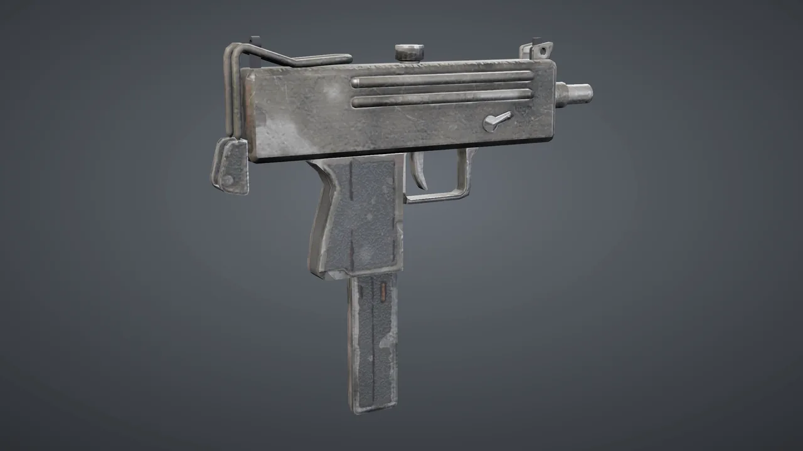

**SMG** `smg`. Light, fast and steady on the move. The pick for clearing rooms and running between them.

| Default | |
| --- | --- |
| Damage | 16 (dart) |
| Fire rate | 768 rpm |
| Fire modes | auto, semi, burst |
| Burst | 3 rounds |
| Magazine | 30 + 120 reserve |
| Reload | 1.8 s |
| Spread | 0.7 deg standing, 2.4 moving, 0.6 crouched, 5 airborne |
| Bloom | +0.26 deg per shot, up to 4.5 |
| Recoil | 0.26 deg up, 0.14 deg side |
| Range | 80 m |
| Draw time | 0.27 s |
| Weight | 2.8 kg |

*Rates are the time between shots and ignore reloading; rpm is the cyclic rate of an automatic weapon.*

### Carbine

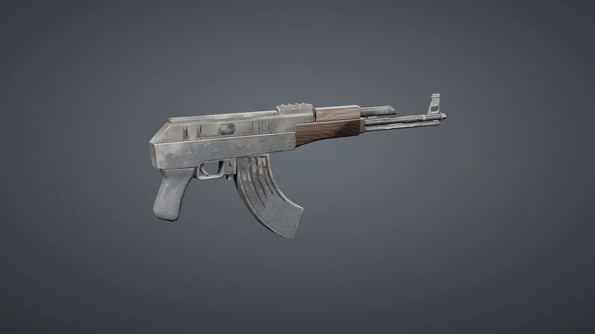

**Assault rifle** `carbine`. A short rifle that handles like an SMG and still reaches across a map. Auto, semi and burst.

| Default | |
| --- | --- |
| Damage | 21 (dart) |
| Fire rate | 640 rpm |
| Fire modes | auto, semi, burst |
| Burst | 3 rounds |
| Magazine | 24 + 96 reserve |
| Reload | 2 s |
| Spread | 0.5 deg standing, 2.1 moving, 0.55 crouched, 4.5 airborne |
| Bloom | +0.28 deg per shot, up to 4.2 |
| Recoil | 0.34 deg up, 0.14 deg side |
| Range | 140 m |
| Draw time | 0.3 s |
| Weight | 3.4 kg |

*Rates are the time between shots and ignore reloading; rpm is the cyclic rate of an automatic weapon.*

### Assault Rifle

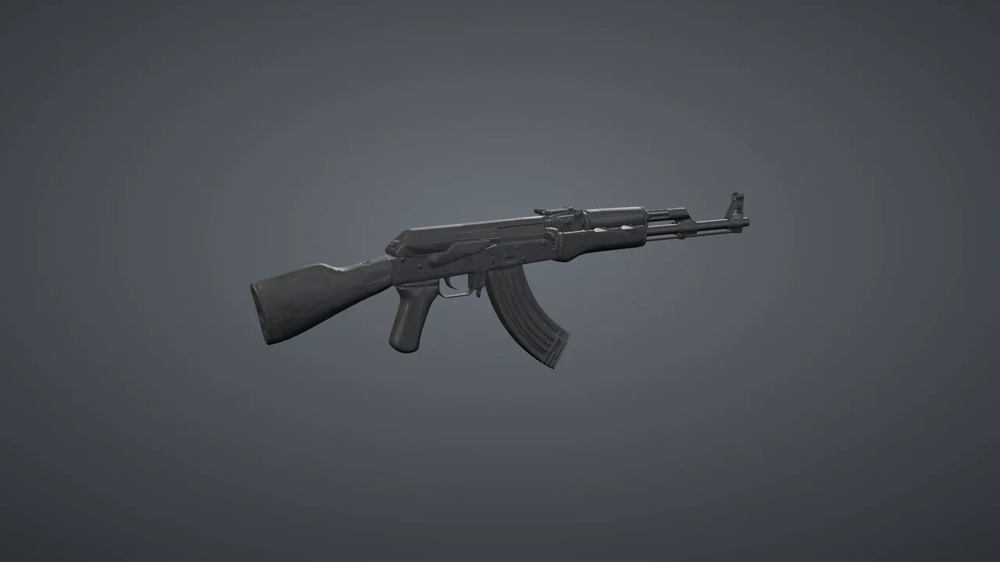

**Assault rifle** `rifle`. The all-rounder. A full 30-round magazine, a clean recoil pattern and the range to hold a long lane.

| Default | |
| --- | --- |
| Damage | 23 (dart) |
| Fire rate | 640 rpm |
| Fire modes | auto, semi, burst |
| Burst | 3 rounds |
| Magazine | 30 + 120 reserve |
| Reload | 2.2 s |
| Spread | 0.45 deg standing, 2.2 moving, 0.5 crouched, 4.8 airborne |
| Bloom | +0.27 deg per shot, up to 4.6 |
| Recoil | 0.36 deg up, 0.15 deg side |
| Range | 180 m |
| Draw time | 0.31 s |
| Weight | 3.8 kg |

*Rates are the time between shots and ignore reloading; rpm is the cyclic rate of an automatic weapon.*

### Bullpup

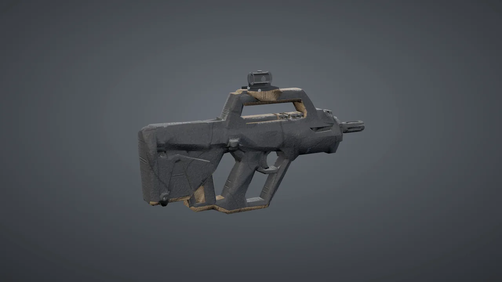

**Assault rifle** `bullpup`. A compact bullpup with an SMG's fire rate and a rifle's magazine. Tight up close, controllable at range.

| Default | |
| --- | --- |
| Damage | 20 (dart) |
| Fire rate | 768 rpm |
| Fire modes | auto, semi, burst |
| Burst | 3 rounds |
| Magazine | 32 + 128 reserve |
| Reload | 2.41 s |
| Spread | 0.5 deg standing, 1 moving, 0.45 crouched, 3.4 airborne |
| Bloom | +0.3 deg per shot, up to 4 |
| Recoil | 0.32 deg up, 0.2 deg side |
| Range | 150 m |
| Draw time | 0.34 s |
| Weight | 4.2 kg |

*Rates are the time between shots and ignore reloading; rpm is the cyclic rate of an automatic weapon.*

### Battle Rifle

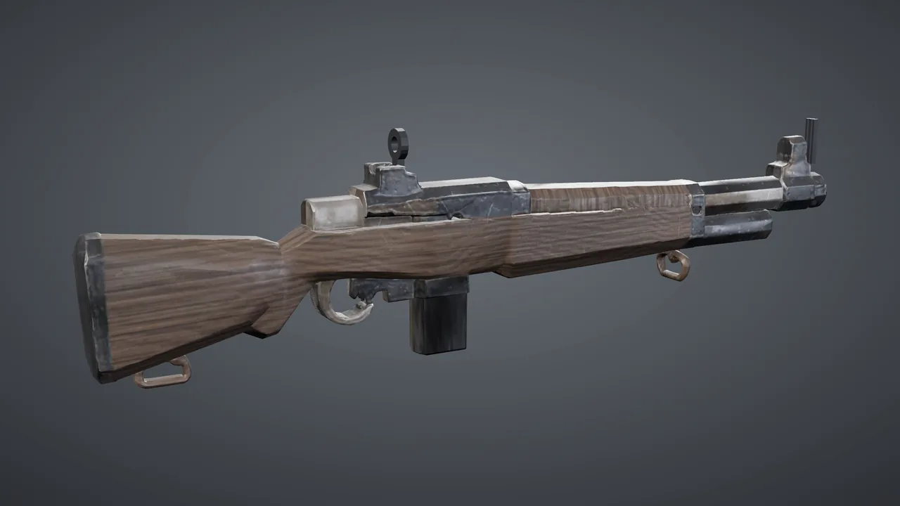

**Battle rifle** `battle_rifle`. Semi-automatic and hard hitting. Three hits finish most targets, and it holds its accuracy out to 200 m.

| Default | |
| --- | --- |
| Damage | 36 (dart) |
| Fire rate | one shot every 0.2 s |
| Fire modes | semi |
| Magazine | 20 + 80 reserve |
| Reload | 2.3 s |
| Spread | 0.25 deg standing, 2.6 moving, 0.4 crouched, 5 airborne |
| Bloom | +0.7 deg per shot, up to 4 |
| Recoil | 1.1 deg up, 0.2 deg side |
| Range | 200 m |
| Draw time | 0.36 s |
| Weight | 4.4 kg |

*Rates are the time between shots and ignore reloading; rpm is the cyclic rate of an automatic weapon.*

### Burst Rifle

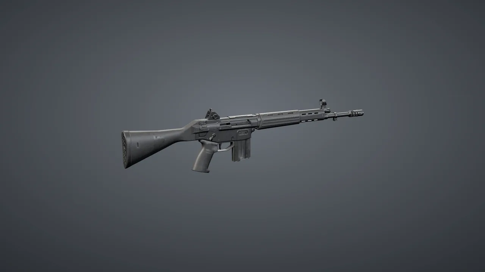

**Burst rifle** `burst_rifle`. Three-round bursts by default, with light recoil that keeps the whole burst on target at mid range.

| Default | |
| --- | --- |
| Damage | 24 (dart) |
| Fire rate | one shot every 0.25 s |
| Fire modes | burst, semi, auto |
| Burst | 3 rounds |
| Magazine | 30 + 90 reserve |
| Reload | 2.09 s |
| Spread | 0.3 deg standing, 1.8 moving, 4.5 airborne |
| Bloom | +0.2 deg per shot, up to 2 |
| Recoil | 0.55 deg up, 0.12 deg side |
| Range | 160 m |
| Draw time | 0.3 s |
| Weight | 3.6 kg |

*Rates are the time between shots and ignore reloading; rpm is the cyclic rate of an automatic weapon.*

### Shotgun

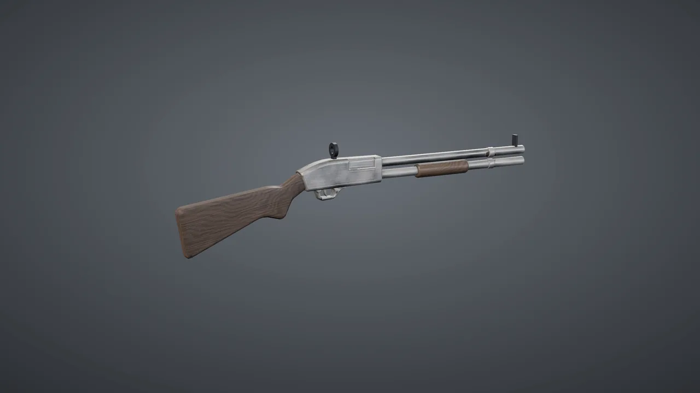

**Shotgun** `shotgun`. A pump gun loaded a shell at a time. Nine pellets at close range end most arguments in one shot.

| Default | |
| --- | --- |
| Damage | 12 x 9 pellets (dart) |
| Fire rate | one shot every 0.8 s |
| Fire modes | semi |
| Magazine | 8 + 32 reserve |
| Reload | 0.42 s per round |
| Spread | 4.2 deg standing, 0.5 moving, 4.2 airborne |
| Recoil | 2.4 deg up, 0.2 deg side |
| Range | 26 m |
| Draw time | 0.38 s |
| Weight | 3.6 kg |

*Rates are the time between shots and ignore reloading; rpm is the cyclic rate of an automatic weapon.*

### Drum Shotgun

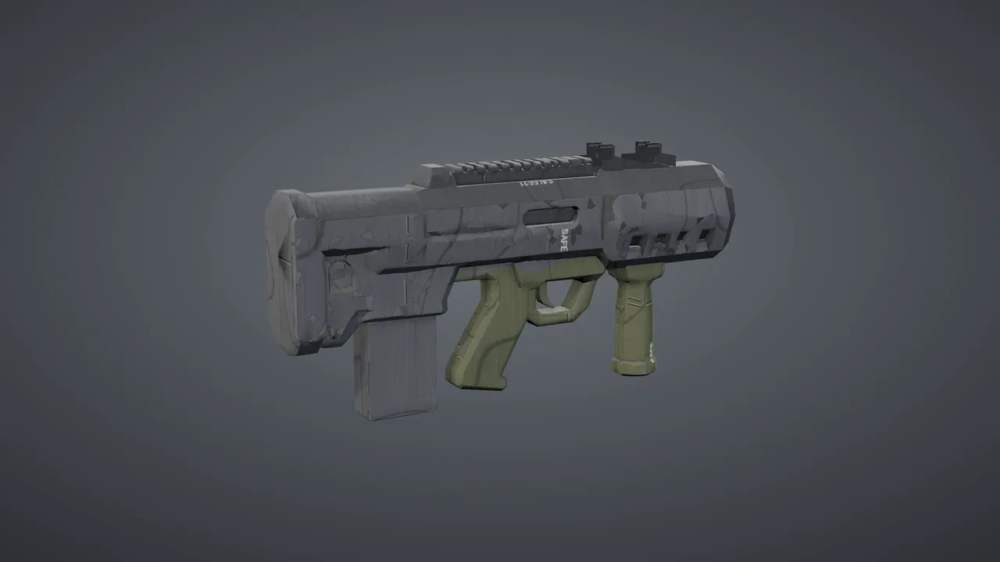

**Shotgun** `drum_shotgun`. A fully automatic shotgun with a 20-round drum. Devastating in a doorway, slow to reload once it runs dry.

| Default | |
| --- | --- |
| Damage | 8 x 7 pellets (dart) |
| Fire rate | one shot every 0.31 s |
| Fire modes | auto, semi |
| Magazine | 20 + 40 reserve |
| Reload | 4 s |
| Spread | 5.4 deg standing, 1.2 moving, 5.4 airborne |
| Recoil | 1.1 deg up, 0.2 deg side |
| Range | 20 m |
| Draw time | 0.42 s |
| Weight | 4.6 kg |

*Rates are the time between shots and ignore reloading; rpm is the cyclic rate of an automatic weapon.*

### Marksman Rifle

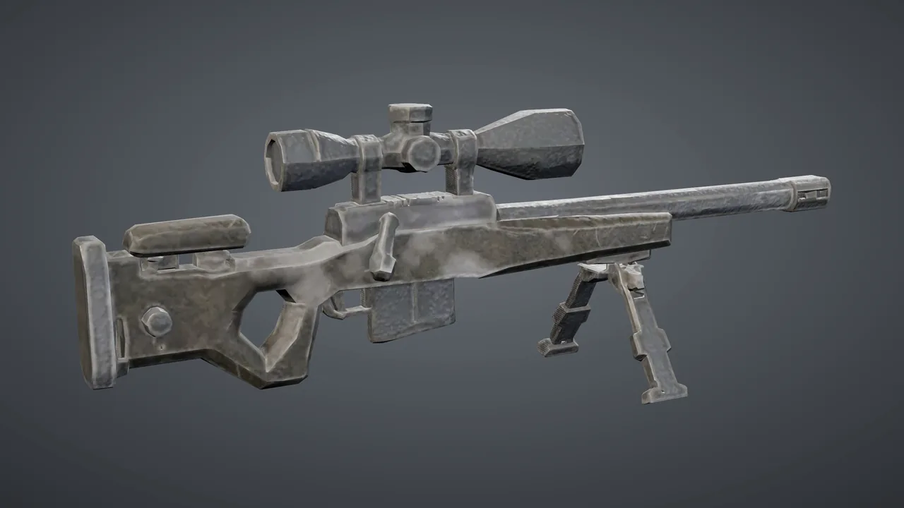

**Marksman rifle** `marksman`. A semi-auto precision rifle for players who want sniper reach without giving up follow-up shots.

| Default | |
| --- | --- |
| Damage | 58 (dart) |
| Fire rate | one shot every 0.33 s |
| Fire modes | semi |
| Magazine | 10 + 40 reserve |
| Reload | 2.59 s |
| Spread | 0.08 deg standing, 4.5 moving, 0.3 crouched, 8 airborne |
| Bloom | +1.4 deg per shot, up to 6 |
| Recoil | 2 deg up, 0.2 deg side |
| Range | 400 m |
| Draw time | 0.45 s |
| Weight | 5 kg |

*Rates are the time between shots and ignore reloading; rpm is the cyclic rate of an automatic weapon.*

### Light Machine Gun

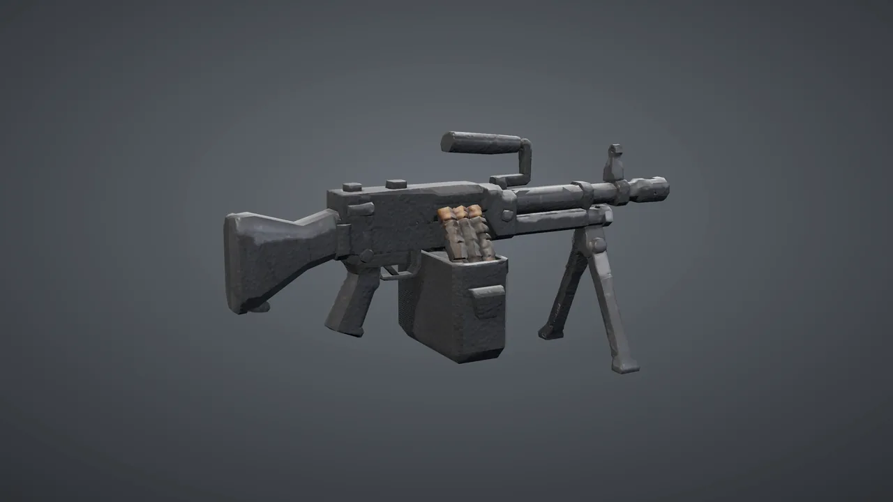

**LMG** `lmg`. A 100-round belt and a bipod-steady crouched spread. Lock down a lane and keep the trigger held.

| Default | |
| --- | --- |
| Damage | 21 (dart) |
| Fire rate | 768 rpm |
| Fire modes | auto, semi |
| Magazine | 100 + 200 reserve |
| Reload | 4.59 s |
| Spread | 0.9 deg standing, 3.8 moving, 0.6 crouched, 6.5 airborne |
| Bloom | +0.18 deg per shot, up to 3.6 |
| Recoil | 0.3 deg up, 0.2 deg side |
| Range | 170 m |
| Draw time | 0.7 s |
| Weight | 7 kg |

*Rates are the time between shots and ignore reloading; rpm is the cyclic rate of an automatic weapon.*

### Sniper Rifle

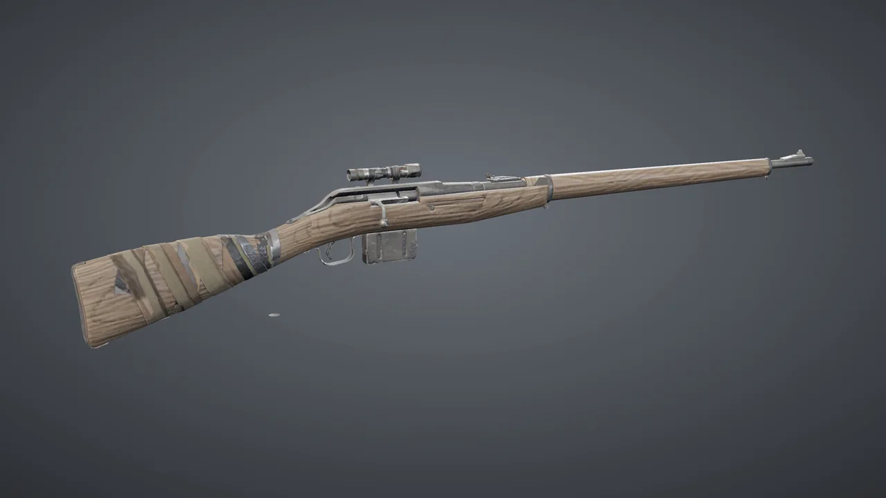

**Sniper rifle** `sniper`. One shot, one kill at any range, provided you are standing still. It punishes movement hard.

| Default | |
| --- | --- |
| Damage | 118 (dart) |
| Fire rate | one shot every 1.33 s |
| Fire modes | semi |
| Magazine | 5 + 25 reserve |
| Reload | 3.2 s |
| Spread | 0 deg standing, 8 moving, 14 airborne |
| Recoil | 4 deg up, 0.2 deg side |
| Range | 1000 m |
| Draw time | 0.7 s |
| Weight | 6 kg |

*Rates are the time between shots and ignore reloading; rpm is the cyclic rate of an automatic weapon.*

### Minigun

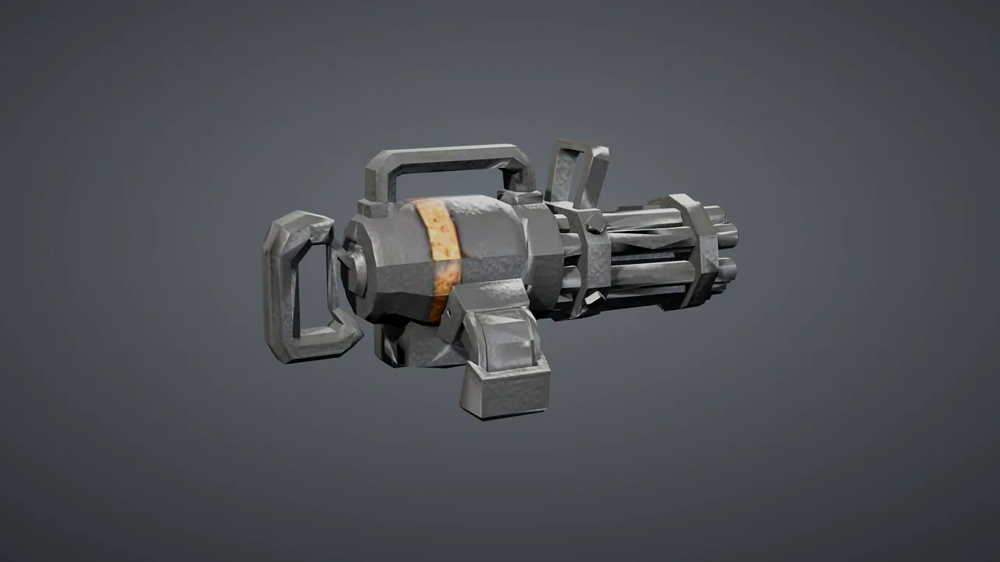

**Heavy** `minigun`. Spins up to the highest fire rate in the pack and never needs a reload. Slow to draw and hard to aim on the run.

| Default | |
| --- | --- |
| Damage | 11 (dart) |
| Fire rate | 1280 rpm |
| Fire modes | auto, semi |
| Spread | 2.4 deg standing, 4.5 moving, 2 crouched, 7 airborne |
| Bloom | +0.08 deg per shot, up to 2 |
| Recoil | 0.12 deg up, 0.1 deg side |
| Range | 110 m |
| Draw time | 1.09 s |
| Weight | 9 kg |

*Rates are the time between shots and ignore reloading; rpm is the cyclic rate of an automatic weapon.*

### Rocket Launcher

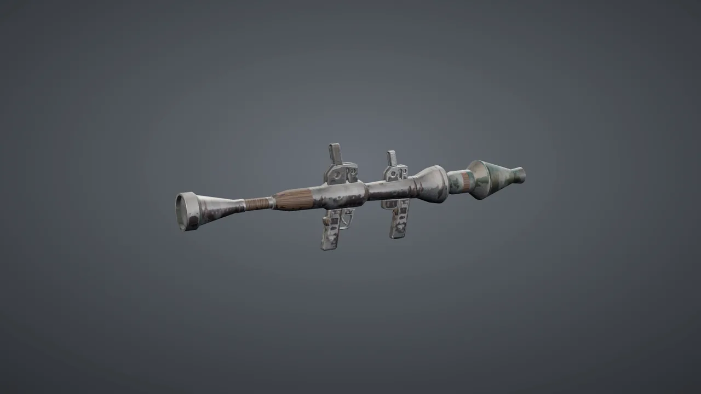

**Launcher** `launcher`. A single-shot rocket launcher with a wide blast. Aim at the feet and let the splash do the work.

| Default | |
| --- | --- |
| Damage | 32 (blast) |
| Splash | 88 within 5.5 m |
| Fire rate | one shot every 0.86 s |
| Fire modes | semi |
| Magazine | 1 + 12 reserve |
| Reload | 2.8 s |
| Recoil | 3 deg up, 0.2 deg side |
| Projectile speed | 44 m/s |
| Draw time | 0.5 s |
| Weight | 6.5 kg |

*Rates are the time between shots and ignore reloading; rpm is the cyclic rate of an automatic weapon.*

### Quad Rocket Launcher

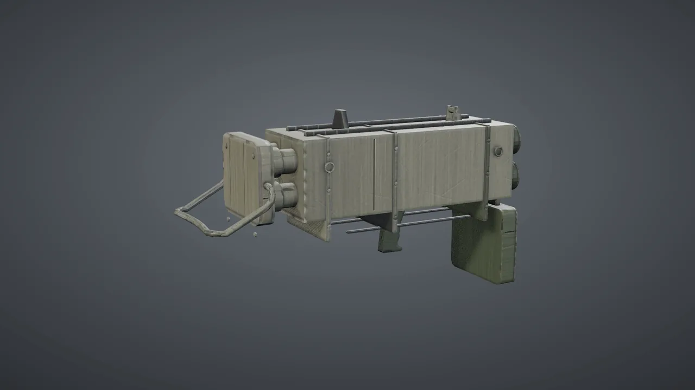

**Launcher** `quad_launcher`. Four rockets in quick succession. Smaller blasts than the single launcher, but far more of them.

| Default | |
| --- | --- |
| Damage | 24 (blast) |
| Splash | 62 within 3.6 m |
| Fire rate | one shot every 0.25 s |
| Fire modes | semi |
| Magazine | 4 + 8 reserve |
| Reload | 4.2 s |
| Spread | 1.2 deg standing, 0 crouched |
| Recoil | 3 deg up, 0.2 deg side |
| Projectile speed | 44 m/s |
| Draw time | 0.5 s |
| Weight | 8 kg |

*Rates are the time between shots and ignore reloading; rpm is the cyclic rate of an automatic weapon.*

### Grenade Launcher

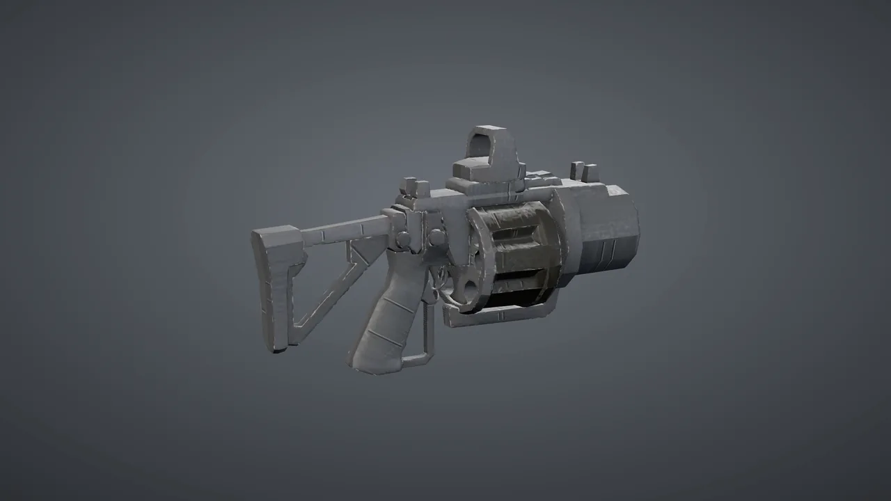

**Launcher** `grenade_launcher`. Lobs bouncing grenades in an arc. Clears corners and covers ground you cannot see.

| Default | |
| --- | --- |
| Damage | 20 (blast) |
| Splash | 95 within 4 m |
| Fire rate | one shot every 0.67 s |
| Fire modes | semi |
| Magazine | 6 + 18 reserve |
| Reload | 3.41 s |
| Recoil | 3 deg up, 0.2 deg side |
| Projectile speed | 28 m/s |
| Draw time | 0.5 s |
| Weight | 5.5 kg |

*Rates are the time between shots and ignore reloading; rpm is the cyclic rate of an automatic weapon.*

### Plasma Beamer

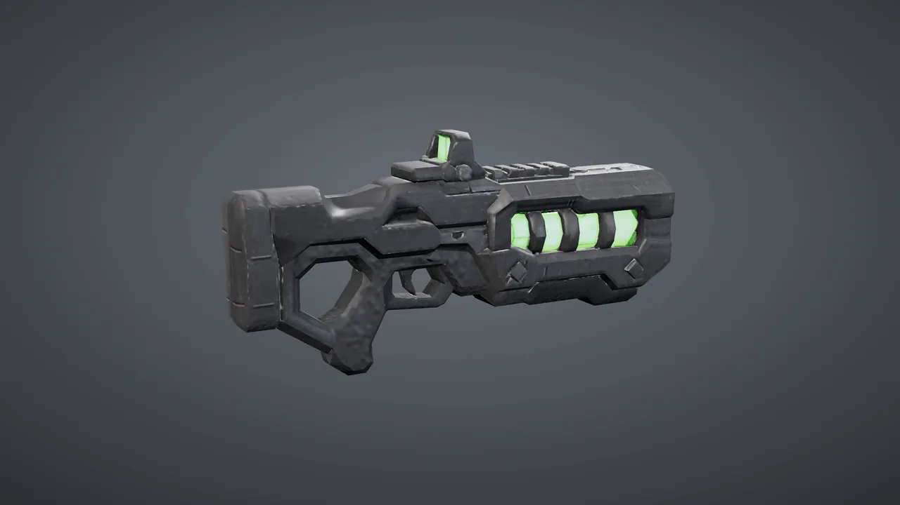

**Energy** `beamer`. A continuous plasma beam. Low damage per tick at a very high rate, so it melts anything you can keep it on.

| Default | |
| --- | --- |
| Damage | 9 (energy) |
| Fire rate | 960 rpm |
| Fire modes | hold |
| Range | 40 m |
| Draw time | 0.41 s |
| Weight | 6 kg |

*Rates are the time between shots and ignore reloading; rpm is the cyclic rate of an automatic weapon.*

### Rail Rifle

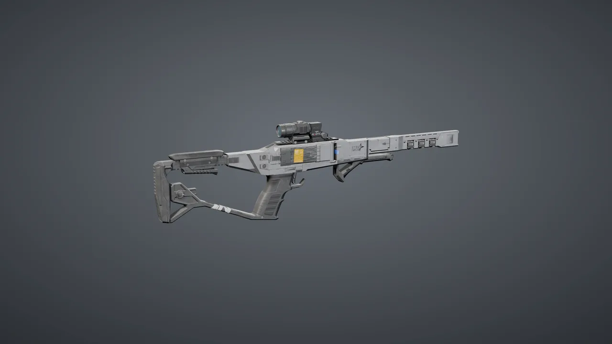

**Energy** `charge_rifle`. Hold to charge, release to fire a rail slug that crosses the map instantly. A full charge hits harder than the sniper.

| Default | |
| --- | --- |
| Damage | 105 (energy) |
| Uncharged damage | 33 % |
| Full charge | 1.09 s |
| Fire rate | one shot every 0.67 s |
| Fire modes | charge |
| Magazine | 4 + 24 reserve |
| Reload | 2.59 s |
| Spread | 0 deg standing, 3 moving, 6 airborne |
| Recoil | 2.6 deg up, 0.2 deg side |
| Range | 500 m |
| Draw time | 0.5 s |
| Weight | 6 kg |

*Rates are the time between shots and ignore reloading; rpm is the cyclic rate of an automatic weapon.*

### Frag Grenade

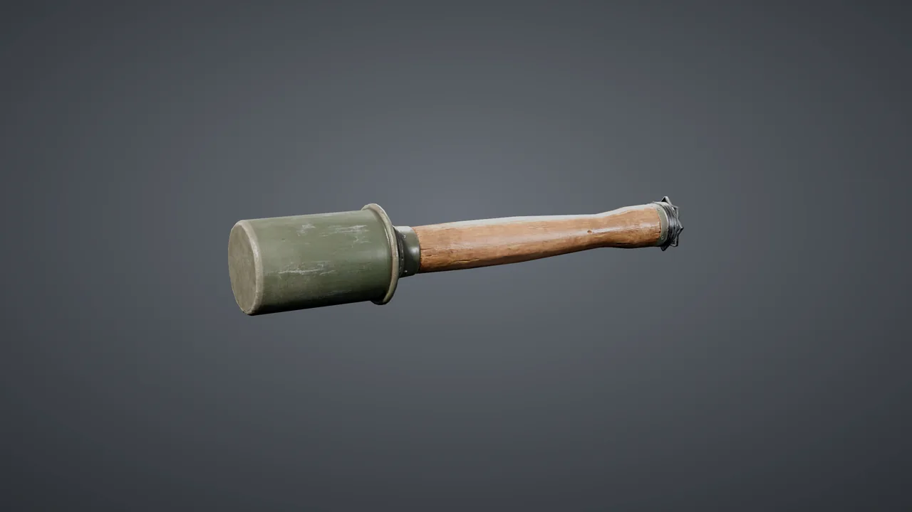

**Grenade** `frag`. The classic stick grenade. Cook it, throw it and clear the room.

| Default | |
| --- | --- |
| Splash | 115 within 5.2 m |
| Fire rate | one throw every 1 s |
| Fire modes | charge |
| Carried | 2 (max 4) |
| Recoil | 0.4 deg up, 0.15 deg side |
| Projectile speed | 19 m/s |
| Fuse | 3 s |
| Draw time | 0.34 s |
| Weight | 0.4 kg |

*Rates are the time between shots and ignore reloading; rpm is the cyclic rate of an automatic weapon.*

### Sticky Grenade

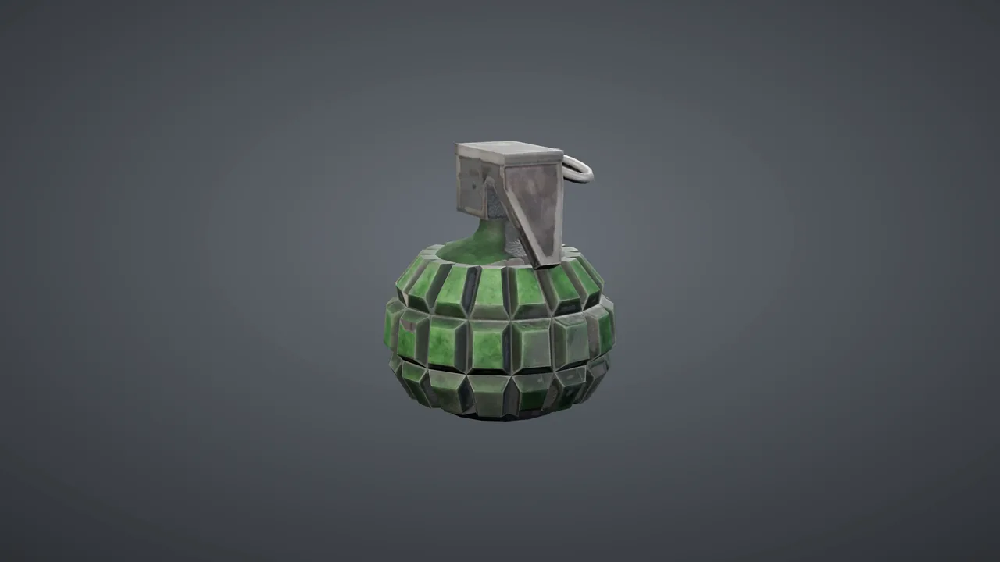

**Grenade** `sticky`. Sticks to whatever it hits, then detonates with the biggest blast of any grenade in the pack.

| Default | |
| --- | --- |
| Splash | 135 within 4 m |
| Fire rate | one throw every 1 s |
| Fire modes | charge |
| Carried | 2 (max 4) |
| Recoil | 0.4 deg up, 0.15 deg side |
| Projectile speed | 22 m/s |
| Fuse | 2.2 s |
| Draw time | 0.34 s |
| Weight | 0.4 kg |

*Rates are the time between shots and ignore reloading; rpm is the cyclic rate of an automatic weapon.*

### Flashbang

**Grenade** `flash`. Blinds everyone facing it. Throw it ahead of a push and walk in while they recover.

| Default | |
| --- | --- |
| Fire rate | one throw every 1 s |
| Fire modes | charge |
| Carried | 2 (max 4) |
| Recoil | 0.4 deg up, 0.15 deg side |
| Projectile speed | 60 m/s |
| Fuse | 1.59 s |
| Draw time | 0.34 s |
| Weight | 0.3 kg |

*Rates are the time between shots and ignore reloading; rpm is the cyclic rate of an automatic weapon.*

### Smoke Grenade

**Grenade** `smoke`. Pops a thick smoke screen to cut a sightline or cover a crossing.

| Default | |
| --- | --- |
| Fire rate | one throw every 1 s |
| Fire modes | charge |
| Carried | 2 (max 4) |
| Recoil | 0.4 deg up, 0.15 deg side |
| Projectile speed | 60 m/s |
| Fuse | 1.2 s |
| Draw time | 0.34 s |
| Weight | 0.3 kg |

*Rates are the time between shots and ignore reloading; rpm is the cyclic rate of an automatic weapon.*

### Incendiary Grenade

**Grenade** `incendiary`. Sets an area on fire. Low damage on impact, but nobody wants to stand in it.

| Default | |
| --- | --- |
| Splash | 25 within 3 m |
| Fire rate | one throw every 1 s |
| Fire modes | charge |
| Carried | 2 (max 4) |
| Recoil | 0.4 deg up, 0.15 deg side |
| Projectile speed | 18 m/s |
| Fuse | 3 s |
| Draw time | 0.34 s |
| Weight | 0.4 kg |

*Rates are the time between shots and ignore reloading; rpm is the cyclic rate of an automatic weapon.*
<!-- /gen_readme:weapons -->

<!-- gen_readme:quality -->
## Quality and ongoing improvement

The models, textures, sounds and animations in this pack are being improved over time, and some of them are low quality today. Improvement is driven by the Nightly queue, a work queue where agents pick up items, and by a visual judge loop that views rendered frames and files defects until each asset passes repeated clean reviews. Known defects are filed there and fixed in later releases, and the screenshots in this README are regenerated as the assets improve.
<!-- /gen_readme:quality -->

## Credits

| What | Author | Licence |
| --- | --- | --- |
| Most primary guns, rocket launchers, grenades, ammo | Styloo (Guns Asset Pack), Polyy (two low-poly gun packs) | CC0 1.0 |
| Knife, pistol, sniper, rifle, stick grenade | Vinrax, Mateusz Sadek, Lamoot, singaii | CC0 1.0 |
| Attachments, finishing and wear maps | TMC (own work) | CC0 1.0 |
| Per-gun shot sounds | Free Firearm Sound Library authors, KuraiWolf, Tabasco, Michel Baradari, jc-sounds, others | CC0 1.0, CC-BY 3.0 and 4.0 |
| Code in this repository | TMC | MIT |

Full per-asset author, link and licence tables are in [CREDITS.md](CREDITS.md). CC0 asks for no credit, but it is given anyway.
